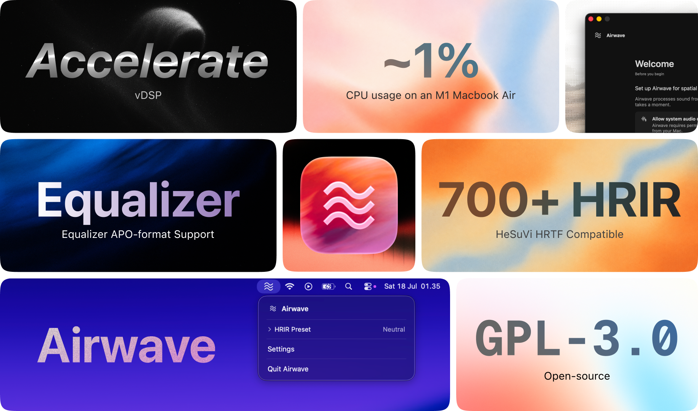
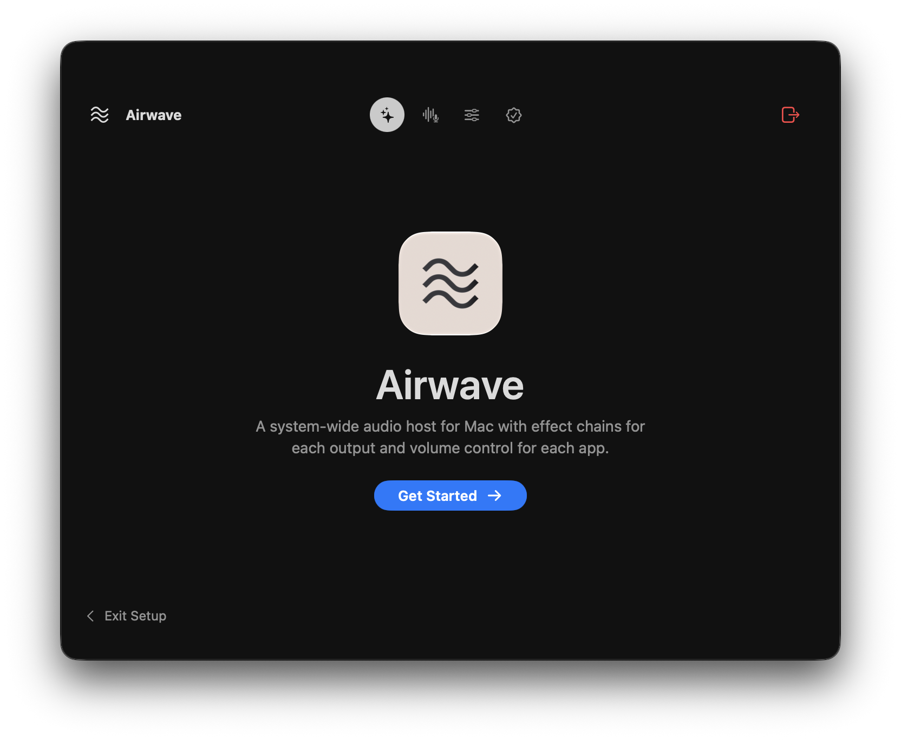
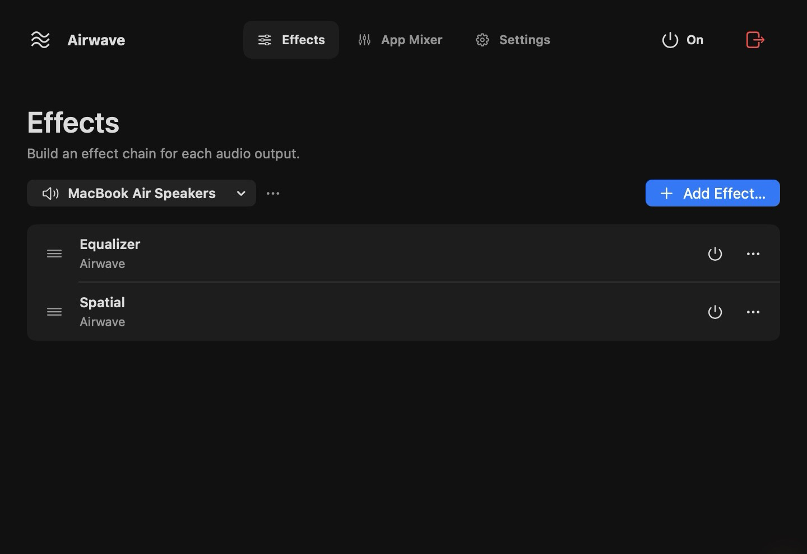

<div align="center">
  <h1>Airwave</h1>
  
  <p>System-wide Audio Unit effects and per-app volume for macOS.</p>
  <p><a href="https://github.com/sallliisa/Airwave/releases"><strong>Download Airwave</strong></a> · <a href="https://github.com/sallliisa/Airwave/issues">Issues</a> · <a href="https://ko-fi.com/Q5Q51RNAGT">Ko-fi</a></p>
</div>

<p align="center">
  
</p>

## What Airwave does

Airwave adds system-wide Audio Unit effects and per-app volume control to macOS without installing a virtual audio driver. It captures playback through macOS System Audio Capture, applies your App Mixer levels, runs the effect chain saved for your active output, and sends the audio to that output.

You keep using the normal macOS volume controls and sound output picker. Each physical output device stores its own effect chain and optional stereo channel pair, so switching between headphones and speakers loads the matching chain.

## Requirements

- macOS 15 Sequoia or later on Intel or Apple silicon.
- A physical audio output device. Airwave accepts stereo and compatible multichannel input. Virtual and aggregate devices are unsupported as playback targets.
- System Audio Capture permission. Airwave does not use or request microphone access.

## Install

### Homebrew

```sh
brew tap sallliisa/airwave
brew install --cask airwave
```

### Direct download

Download the ZIP archive from [GitHub Releases](https://github.com/sallliisa/Airwave/releases), unzip it, and move `Airwave.app` to Applications. Launch Airwave from Applications so macOS registers the bundled Spatial and Equalizer Audio Units.

## First launch

<p align="center">
  
</p>

The first-run setup takes four steps:

1. Connect the headphones or speakers you plan to use and click **Get Started**.
2. Click **Test Audio Access**. Airwave plays a short test sound to verify capture. Allow System Audio Capture if macOS prompts you, then run the test again if needed.
3. Click **Add Effects…** to build a starting chain for your current output, or continue with an empty chain if you only want the App Mixer. Spatial and Equalizer appear under the **Airwave** publisher.
4. Choose whether Airwave launches at login and whether it stays in the menu bar, then click **Finish Setup**.

## Effect chains

<p align="center">
  
</p>

Airwave processes each output's effect chain from top to bottom.

- Click **Add Effect…** to browse or search installed Audio Units. You can add multiple instances of the same Audio Unit with separate settings. Click **Rescan** if you installed a new Audio Unit while Airwave was open.
- Click an effect card to open its controls. Drag cards to reorder them, or use **Move Up** and **Move Down** in the card's ellipsis menu.
- Click an effect's power button to bypass it without losing its settings. Choose **Remove Effect** in the ellipsis menu to delete it from the chain.

Order matters. Put Spatial before Equalizer if you want Equalizer to shape the stereo output of Spatial. Put Equalizer first if you want it to shape the signal going into Spatial.

### Per-device chains and multichannel interfaces

The device picker in **Effects** selects which saved chain you are editing. It does not change the macOS system output. A speaker icon marks the active macOS output, and **Live Output** jumps back to it after you edit another device.

Open the ellipsis menu next to the device picker for device actions:

- **Configure Output…** maps Airwave's left and right stereo output to two specific channels on a connected multichannel interface. Check which physical jacks those channels feed on your interface before saving. Airwave uses the saved pair even when the effect chain is empty. Click **Use macOS Default** inside the sheet to revert.
- **Reset Effects…** clears the effect chain for a connected device and keeps its channel pair.
- **Remove Saved Profile…** deletes the saved chain and channel pair for a disconnected device.

## Bundled Audio Units

Airwave includes two Audio Units, Spatial and Equalizer. Both work inside Airwave and in any other macOS Audio Unit host once you have opened `Airwave.app` from Applications. If both Airwave and another host process the same audio, bypass Airwave or quit it to hear only the other host.

### Spatial

<p align="center">
  
</p>

Spatial applies HRIR convolution so stereo headphones sound closer to speakers. Use it with stereo headphones, because HRIR convolution can sound unnatural on speakers.

Spatial ships with `NeutralSH1.0`, `RoomSH1.0`, and `StageSH1.0`. Click a preset while audio plays to preview it, and toggle the power button to compare against the unprocessed signal. Click **Import…** to add compatible HeSuVi WAV files. More datasets are available in the [HeSuVi HRTF Database](https://airtable.com/embed/appac4r1cu9UpBNAN/shrpUAbtyZxhDDMjg/tblopH2GznvFipWjq/viwnouWPGDuYEd8Go).

### Equalizer

<p align="center">
  
</p>

Equalizer loads Equalizer APO presets and plots the live stereo frequency response. It includes five built-in presets: Bass Booster, Bass Reducer, Treble Booster, Treble Reducer, and Vocal Booster. You can find headphone presets on [AutoEq](https://autoeq.app/).

Click **Import…** to load an Equalizer APO text file, a folder, or an Airwave `.apo` archive. Click **Paste Preset** to import Equalizer APO text from the clipboard. When a config uses `Include` or `Convolution`, import the folder containing `config.txt` and its companion files with relative paths preserved.

<details>
<summary>Supported Equalizer APO syntax and limits</summary>

- Supported filters include `Preamp`, `GraphicEQ`, and standard biquad filters such as peaking, pass, notch, and shelf filters with Q, octave bandwidth, or shelf slope. Write frequencies in decimal Hz or as ungrouped integers such as `6000`.
- `Channel`, `Copy`, and `Delay` run in config order on Equalizer's stereo signal. Reference channels with `L`, `R`, `1`, `2`, or `Channel: all`. `Delay` accepts milliseconds or samples.
- `Convolution` accepts WAV impulse responses up to 0.5 seconds whose sample rate matches the active output. The combined graphic equalizer and convolution response limit is 96,000 frames up to 48 kHz, 48,000 frames up to 96 kHz, and 32,768 frames above 96 kHz.
- `If`, `ElseIf`, `Else`, `EndIf`, `Eval`, and backtick expressions can read the active output's sample rate, channel counts, device name, and UID. Replace Windows device names or GUIDs with the macOS output name or UID. `Stage: post-mix` selects playback; Airwave skips `pre-mix` and `capture` sections.
- `Filter: ON IIR` accepts stable filters from order 1 to 32, up to a combined order of 512 per preset. Use a sample-rate condition when coefficients depend on output rate.
- `Include` and `Convolution` paths must be literal and present at import, including paths inside conditional branches. Windows registry functions, Windows VST plug-ins, and system-volume loudness correction are unsupported.

</details>

## App Mixer

<p align="center">
  
</p>

The App Mixer sets volume and mute per application before audio reaches your output's effect chain. Those adjustments stay active when you switch headphones or speakers.

- Start playback in an app to see it under **Playing & Recent**. macOS alert effects appear under **System Sounds** after a sound plays.
- Drag the slider to change an app's volume, or click its speaker button to mute it without losing the slider position.
- Apps stay in **Playing & Recent** for about 45 seconds after playback stops. Any app with a changed volume or mute state moves to **Saved Adjustments**, where you can edit it later or right-click and choose **Clear Saved Adjustment** to reset it to 100% and unmuted.
- Use the menu bar popover for quick adjustments to playing and recent apps, or click **Open App Mixer** to manage saved adjustments.

## Running in the background

Closing the Airwave window leaves processing active. The main power button in the window pauses both the effect chain and the App Mixer while keeping your saved settings intact.

To quit Airwave and stop processing, choose **Quit Airwave** from the menu bar or use the exit button in the main window. If you disable **Show in Menu Bar** in Settings, reopen Airwave from Applications or Spotlight whenever you want to bring the window back.

## Upgrading from Airwave 2

Airwave 3 uses the same bundle identifier as Airwave 2. Install it over Airwave 2 and open it once to migrate your setup.

Airwave imports saved output profiles, interface channel pairs, compatible presets, and your menu bar preference. Outputs that used both Spatial and Equalizer receive a chain with Spatial first and Equalizer second. Original preset files remain on disk. If an imported preset fails to load, Airwave leaves that effect bypassed until you pick a replacement.

After upgrading, check your active output in **Effects** to confirm the effect order, selected presets, and any custom interface channel pair.

## Troubleshooting

### System audio access fails

Open **Settings**, select **Setup & Troubleshooting**, and click **Test Audio Access**. If macOS already denied permission, click **Open System Settings** on that page, enable Airwave under **Privacy & Security**, and run the test again.

### Effects make no audible change

Confirm that the active macOS output matches the device selected in **Effects** by clicking **Live Output**. Check that both the main power switch and the effect's power button are on, and open the effect's controls to verify that a preset is selected. For Spatial, listen on stereo headphones and toggle bypass while audio plays.

### Audio plays through the wrong interface channels

Select the physical interface in macOS Sound settings. In Airwave's **Effects** tab, open the device ellipsis menu, click **Configure Output…**, verify that the left and right channel numbers match your wired jacks, and save the pair.

### An output device or Audio Unit is missing

Airwave only lists supported physical outputs and keeps saved profiles for disconnected ones. Reconnect the device and verify that macOS lists it as a sound output. For a missing Audio Unit, clear the search box and publisher filter in **Add Effect…**, then click **Rescan**.

### An app does not appear in the App Mixer

Start audio playback in that app, then check **Playing & Recent**. Short macOS alerts appear as **System Sounds**. If you changed the app's volume earlier, check **Saved Adjustments** in the main window. Reopen the menu bar popover to refresh its list.

## Build from source

Open `Airwave.xcodeproj` in full Xcode and select the **Airwave3** scheme. That scheme builds the app and embeds both bundled Audio Units. The **Airwave** scheme builds Airwave 2 for upgrade and compatibility testing. See [docs/airwave-3-release.md](docs/airwave-3-release.md) for packaging and release verification steps.

## License

Airwave is licensed under the [GNU General Public License v3](LICENSE).

## Credits

- Spatial is inspired by [HeSuVi](https://sourceforge.net/projects/hesuvi/). Third-party HRIR datasets remain under their respective licenses.
- [AutoEq](https://autoeq.app/) provides headphone equalizer presets.
- The Airwave icon uses [Material Symbols](https://fonts.google.com/icons).

## Support

Report bugs or request features in [GitHub Issues](https://github.com/sallliisa/Airwave/issues). For audio issues, include your Airwave version, macOS version, output device, and the affected effect or app.

You can also [support Airwave on Ko-fi](https://ko-fi.com/Q5Q51RNAGT).
