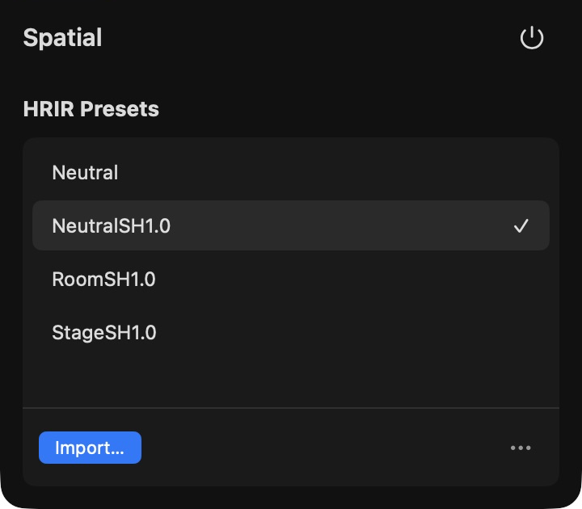

<div align="center">
  
  <h1>Airwave</h1>
  <p>System-wide audio effects and per-app volume for macOS.</p>
  <p><a href="https://github.com/sallliisa/Airwave/releases">Releases</a> · <a href="https://github.com/sallliisa/Airwave/issues">Report an issue</a></p>
</div>

Airwave gives each audio output its own chain of Audio Unit effects. Give your headphones spatial audio, leave your speakers untouched, and lower the volume of a noisy app while your music keeps playing.


## Effects

Choose an output in **Effects**, then click **Add Effect…** to browse installed Audio Units. Search by name or filter by publisher. Click an effect card to open its controls, drag the card to reorder it, or use its power button to bypass that instance. You can add the same effect more than once.

Airwave applies the chain saved for the output selected in macOS. The picker in **Effects** selects which chain you edit. Use the menu next to it to configure the left and right output channels on a supported device.

### Included Audio Units

- **Spatial** gives stereo headphones a more speaker-like presentation using HRIR convolution. It includes `NeutralSH1.0`, `RoomSH1.0`, and `StageSH1.0` and can import compatible HeSuVi WAV files.
- **Equalizer** includes five presets and imports Equalizer APO text configs. It supports parametric filters, graphic EQ, preamp gain, and convolution. For a config that references other text files or WAV impulse responses, import the folder containing `config.txt` and its companion files.

Both effects are bundled with Airwave. You can also use them in another compatible Audio Unit host. Keep Airwave in Applications, open it once, then rescan Audio Units in the other host if needed.



## App Mixer

Play audio in an app and open **App Mixer** to set its volume or mute it. Airwave remembers your adjustments. Quiet apps with custom settings appear under **Saved Adjustments**, where you can edit or clear them. The menu bar mixer gives you quick access to playing and recent apps.


The power control in the main window bypasses both the effect chain and per-app volume adjustments. Closing the window leaves Airwave running in the background. To stop it completely, use the exit button or choose **Quit Airwave** from the menu bar.

## Install and set up

Airwave requires **macOS 15 Sequoia or later** and a supported physical audio output. The host works with speakers and headphones. Use stereo headphones for Spatial.

> This branch documents the Airwave 3 release candidate. The download and Homebrew commands install the latest published release.

Download the ZIP from [GitHub Releases](https://github.com/sallliisa/Airwave/releases) and move `Airwave.app` into Applications, or install with Homebrew.

```sh
brew tap sallliisa/airwave
brew install --cask airwave
```

1. Open Airwave and click **Get Started**.
2. Click **Test Audio Access**. Airwave plays a short test sound. Allow system audio recording if macOS prompts you, then test again if needed. Airwave uses system audio capture. It requires no microphone access.
3. Add any effects you want for the current output, or continue with an empty chain.
4. Choose **Launch at Login** and **Show in Menu Bar** on the final page. You can change both later in **Settings**.

For capture or routing issues, open **Setup & Troubleshooting** in **Settings** and run the audio test again. Check that macOS has selected the intended output and that Airwave is on. For an interface, also check the saved channel pair in **Configure Output**.

## Upgrading from Airwave 2

Airwave 3 imports supported Airwave 2 device profiles and presets. If an output used both Spatial and Equalizer, its new chain puts Spatial first. Imported presets are available in the respective effect controls and the original preset files stay on disk. If an assigned preset can’t be opened, its effect stays bypassed until you pick a replacement.

## Build from source

Open `Airwave.xcodeproj` in full Xcode and run the **Airwave3** scheme. The **Airwave** scheme builds Airwave 2 for compatibility checks. See the [Airwave 3 release rehearsal](docs/airwave-3-release.md) for packaging and upgrade verification.

## License and credits

Airwave is licensed under the [GNU General Public License v3](LICENSE).

- Spatial is inspired by [HeSuVi](https://sourceforge.net/projects/hesuvi/). Third-party HRIR datasets remain subject to their respective licenses.
- [AutoEq](https://autoeq.app/) is a source of headphone equalizer presets.
- The Airwave mark uses [Material Symbols](https://fonts.google.com/icons).

If you find Airwave useful, you can [support development on Ko-fi](https://ko-fi.com/Q5Q51RNAGT).
