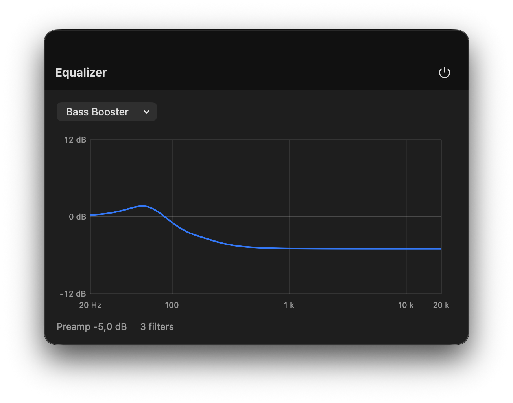
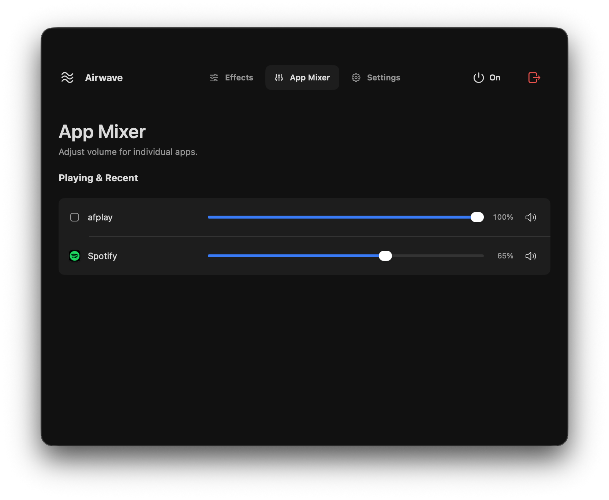
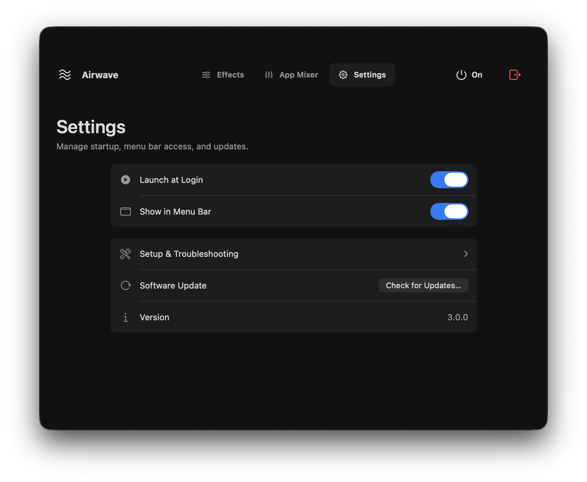

<div align="center">
  <h1>Airwave</h1>
  
  <p>System-wide audio effects and per-app volume for macOS.</p>
  <p><a href="https://github.com/sallliisa/Airwave/releases"><strong>Download Airwave</strong></a> · <a href="https://github.com/sallliisa/Airwave/issues">Support</a> · <a href="https://ko-fi.com/Q5Q51RNAGT">Ko-fi</a></p>
</div>

<p align="center">
  
</p>

## What Airwave does

Airwave captures playback from your Mac, applies the effect chain for your current audio output, and plays the result through that output. Each output has its own chain. You can keep Spatial and Equalizer on your headphones, use a different EQ on your speakers, and leave another output with an empty chain.

The App Mixer adjusts volume or mute for individual apps. Those adjustments apply before the output's effects. You can turn a browser down without changing your music volume, then change headphones without having to set the browser volume again.

macOS still controls the current output and its overall volume. In Airwave, the output picker selects the chain you want to edit. It also lets you edit a saved chain while another output is playing.

## Requirements

- macOS 15 Sequoia or later on an Intel or Apple silicon Mac.
- A supported physical audio output. Airwave supports stereo and compatible multichannel input. Virtual and aggregate devices are unsupported as playback targets.
- System Audio Capture permission. Airwave uses playback audio for effects and mixing. It requires no microphone access.

Speakers and headphones work with the host. Use stereo headphones for Spatial. HRIR convolution is intended to make headphones sound more speaker-like and can sound different through speakers.

## Installation

This README covers the Airwave 3 release candidate. The download and Homebrew commands below install the latest published release. To try the candidate before it ships, use [Build from source](#build-from-source).

### Homebrew

```sh
brew tap sallliisa/airwave
brew install --cask airwave
```

### Download

Download the ZIP from [GitHub Releases](https://github.com/sallliisa/Airwave/releases), unzip it, and move `Airwave.app` into Applications. Open Airwave from there so macOS can register both bundled Audio Units.

## First launch

### 1. Welcome

Open Airwave and click **Get Started**. Have your usual playback device connected so you can test the output you plan to use.

<p align="center">
  
</p>

### 2. Allow system audio

Click **Test Audio Access**. Airwave plays a short test sound and checks whether it can capture playback. If macOS asks for permission to record system audio, allow it and run the test again if needed. Continue when Airwave reports **System audio is ready**.

If the test fails, the page shows the reason and offers to open System Settings. Once access is enabled and the output is connected, click **Test Again**.

### 3. Add effects

Click **Add Effects…** to open the Audio Unit picker for your current output. Choose as many effects as you want, then click **Done**. The order you add them is the order in which they process audio. You can reorder the chain later.

Choose Airwave in **All Publishers** to find Spatial and Equalizer. You can also continue with an empty chain and use Airwave for app volume control alone.

### 4. Finish setup

Choose whether Airwave should launch at login and whether it should appear in the menu bar. **Show in Menu Bar** starts enabled on a fresh setup. Both options are also available in Settings. Click **Finish Setup** to open the main window.

## Effect chains

<p align="center">
  
</p>

### Add, open, or reorder an effect

1. Open **Effects** and select an output in the device picker.
2. Click **Add Effect…**. Search by effect or publisher name, or choose a publisher from **All Publishers**. Click **Rescan** if you installed an Audio Unit while Airwave was open.
3. Click the effect to add it. Repeat to add another instance of the same Audio Unit with its own settings.
4. Click an effect card to open its controls. Drag the card to reorder it, or choose **Move Up** or **Move Down** from its ellipsis menu. Airwave processes the chain from top to bottom.

Use an effect's power button to bypass that instance without losing its settings. The power button in the controls window changes the same state. Use **Remove Effect** in the ellipsis menu to remove the instance from the chain.

For example, put Spatial before Equalizer if you want the EQ to shape the stereo signal that comes out of Spatial. Put an EQ first if you want it to shape the signal that goes into Spatial. The order is part of the saved output chain.

### Switch outputs or configure an interface

When you change the macOS sound output, Airwave uses the chain saved for that device. Choose another device in **Effects** if you want to prepare its chain ahead of time. The speaker icon on a device identifies the current macOS output. **Live Output** takes you back to editing that output.

The ellipsis next to the output picker contains the device actions.

| Action | What it does |
| --- | --- |
| **Configure Output…** | Assigns Airwave's left and right stereo signal to two distinct channels on a supported output. Connect the device to configure its available channels. |
| **Reset Effects…** | Clears the effect chain for a connected output and keeps its saved channel assignment. |
| **Remove Saved Profile…** | Removes the chain and channel assignment for a disconnected device. Reconnect the device to configure it again. |

A saved channel number is a destination on the device. Check which physical jack it reaches before choosing the pair. For example, if your monitors are wired to outputs 3 and 4 on an interface, assign channel 3 to the left speaker and channel 4 to the right. Airwave uses the saved pair even if your chain is empty. If you want the device's default stereo pair back, open **Configure Output…** and click **Use macOS Default**.

## Bundled Audio Units

Airwave ships Spatial and Equalizer in the same application. Add either from the Airwave publisher in **Add Effect…**. Click its card to choose a preset. Each instance keeps its own selection, so the same plug-in can use a different preset on each output.

### Spatial

Spatial uses HRIR convolution to give stereo headphones a wider, more speaker-like sound. The library includes `NeutralSH1.0`, `RoomSH1.0`, and `StageSH1.0`. Open Spatial's controls and click a preset to hear it while audio plays. Use the power button to compare it with the dry signal.

<p align="center">
  
</p>

To add your own HRIR, click **Import…** and select a compatible HeSuVi WAV file. Bundled and imported presets share the same library. The ellipsis contains the preset management actions. The [HeSuVi HRTF Database](https://airtable.com/embed/appac4r1cu9UpBNAN/shrpUAbtyZxhDDMjg/tblopH2GznvFipWjq/viwnouWPGDuYEd8Go) has more datasets.

### Equalizer

Equalizer imports Equalizer APO text presets and displays the frequency response for the preset in use. It includes Bass Booster, Bass Reducer, Treble Booster, Treble Reducer, and Vocal Booster. Use the preset picker in the controls window to switch presets. Use the effect power button to compare with the original signal, or **Clear Preset** to clear the selection in that instance.

<p align="center">
  
</p>

Click **Import…** for an Equalizer APO text file, folder, or Airwave `.apo` archive. **Paste Preset** takes Equalizer APO text from the clipboard. Use a folder import when a config calls `Include` or `Convolution`. Select the folder containing `config.txt` and all companion files. Keep relative paths inside it. If Airwave asks for access to companion files after you select the config directly, choose the folder that contains them. [AutoEq](https://autoeq.app/) is a source of headphone presets.

The importer supports `Preamp`, `GraphicEQ`, and common biquad filters such as peaking, pass, notch, and shelf filters. Use Q, octave bandwidth, or shelf slope where the filter accepts it. Write frequencies in decimal Hz or as ungrouped integers such as `6000`.

For presets with routing or device-dependent instructions:

- `Channel`, `Copy`, and `Delay` operate in config order on Equalizer's stereo signal. Use `L`, `R`, `1`, or `2` to reference a channel. `Channel: all` selects both channels. Delay accepts milliseconds or samples.
- `Convolution` accepts WAV impulse responses up to 0.5 seconds. The WAV sample rate must match the output. The combined graphic EQ and convolution response limit is 96,000 frames through 48 kHz, 48,000 frames through 96 kHz, and 32,768 frames above 96 kHz.
- `If`, `ElseIf`, `Else`, `EndIf`, `Eval`, and backtick expressions can use output information supplied by Airwave. Available values include sample rate, channel counts, and device name or UID. If a preset targets a Windows device name or GUID, replace it with the macOS output name or UID. `Stage: post-mix` selects playback. Airwave skips `pre-mix` and `capture` sections.
- `Filter: ON IIR` accepts stable filters of order 1 through 32. The combined order limit for a preset is 512. Use a sample-rate condition when your coefficients vary by rate.
- `Include` and `Convolution` paths must be literal and available at import, including files referenced inside conditions. Windows registry functions, Windows VST plug-ins, and system-volume loudness correction are outside the supported config syntax.

### Use them in another Audio Unit host

Install Airwave in Applications, open it once, and look for Spatial and Equalizer under **Airwave** in the other app's Audio Unit list. Rescan Audio Units or reopen that host if the effects are missing. Choose the effect on the track or output you want to process. If both hosts process the same playback, bypass Airwave's system-wide processing or quit Airwave to hear the other host's processing by itself.

## App Mixer

<p align="center">
  
</p>

Play audio in an app so it appears in **Playing & Recent**. Move its slider to set the volume and click the speaker button to mute or unmute it. Muting keeps the slider's current value. **System Sounds** is the row for macOS sound effects after one plays.

Airwave keeps apps in **Playing & Recent** for about 45 seconds after they stop producing audio. When an adjusted app drops out of that list, it moves to **Saved Adjustments**. You can change its volume or mute there before it plays again. Right-click a saved row and choose **Clear Saved Adjustment** to return it to 100% and unmute it.

The menu bar mixer is for quick access. It lists playing and recent apps and uses the same controls and saved values as the main window. Click **Open App Mixer** to manage saved adjustments. Changing the macOS master volume still affects the whole output.

For example, if you keep music playing during a call, you can lower the music app in the mixer and leave the call at 100%. Airwave applies those settings again the next time either app plays. If you switch to headphones, their saved effects apply to the mix at the new output.

## Running Airwave

The main window's power control pauses both the effect chain and the App Mixer. Switch it back on to resume with the same chain, sliders, and mute settings.

Closing the window leaves Airwave running. Choose **Quit Airwave** from the menu bar or use the exit button in the window to stop processing and quit. If you hide the menu bar icon, reopen Airwave from Applications or Spotlight to bring its window back.

### Settings

- **Launch at Login** starts Airwave after you sign in.
- **Show in Menu Bar** gives you access to the quick mixer and Quit Airwave. Airwave can run in the background with this setting off.
- **Setup & Troubleshooting** reopens setup so you can run the capture test again.
- **Software Update** checks for a newer published version when the installed build supports updates.
- **Version** shows the installed version.

<p align="center">
  
</p>

## Upgrading from Airwave 2

Airwave 3 uses the same application identity. Install it over Airwave 2 or use the normal updater once Airwave 3 is published. Open it so it can import your existing configuration.

Airwave imports saved output profiles, channel assignments, and compatible presets. An output that used both Spatial and EQ gets a chain with Spatial first and Equalizer second. Open each effect's controls to find imported presets. Airwave leaves the original preset files on disk. If an assigned preset cannot be loaded, the affected effect stays bypassed until you choose a replacement. Other saved effects remain available.

After an upgrade, open **Effects** and select your usual output. Verify the effect order and open each effect to check its selected preset. If you used a custom interface channel pair in Airwave 2, check that pair in the device menu before you play through the interface. Your saved menu bar choice carries over.

## Troubleshooting

### System audio access fails

Open **Settings**, then **Setup & Troubleshooting**, and choose **Test Audio Access**. If macOS prompts for permission, allow Airwave to capture system audio. If access is already denied, use **Open System Settings** on the test page and update Airwave's permission under **Privacy & Security**. Run the test again.

### An effect has no audible result

Check the macOS output and the output selected in **Effects**. Use **Live Output** to edit the chain that is playing. Check that the main power control and the effect's power control are both on. Open the effect's controls and check its preset. For Spatial, listen through stereo headphones. Try bypassing the effect while a track plays to compare the two signals.

### Audio reaches the wrong channels

Choose the physical output in macOS. In **Effects**, open the device menu and choose **Configure Output…**. Confirm the two channel numbers correspond to the jacks you are using, then save the left and right assignments together.

### An output or Audio Unit is missing

Reconnect the output and check that it appears under macOS sound outputs. Airwave lists supported physical outputs and retains saved profiles for disconnected devices. For a missing Audio Unit, check the installation, clear the search and publisher filter in **Add Effect…**, then click **Rescan**.

### An app is missing from the mixer

Start playback in the app, then look in **Playing & Recent**. A short system alert can appear as **System Sounds**. If you previously muted the app or changed its volume, look under **Saved Adjustments** in the main window as well. Open the menu bar mixer again to refresh its list of recent apps.

## Build from source

Open `Airwave.xcodeproj` in full Xcode and choose the **Airwave3** scheme. It builds the host and embeds the Spatial and Equalizer Audio Units. The **Airwave** scheme builds the Airwave 2 app for compatibility checks. See the [Airwave 3 release rehearsal](docs/airwave-3-release.md) for build, packaging, and upgrade verification.

## License

Airwave is licensed under the [GNU General Public License v3](LICENSE).

## Credits

- Spatial is inspired by [HeSuVi](https://sourceforge.net/projects/hesuvi/). Third-party HRIR datasets remain subject to their respective licenses.
- [AutoEq](https://autoeq.app/) provides headphone equalizer presets.
- The Airwave mark uses [Material Symbols](https://fonts.google.com/icons).

## Support

For bugs and feature requests, [open an issue on GitHub](https://github.com/sallliisa/Airwave/issues). For audio issues, include your Airwave version, macOS version, output device, and the affected effect or app.

If Airwave is useful to you, you can [support its development on Ko-fi](https://ko-fi.com/Q5Q51RNAGT).
